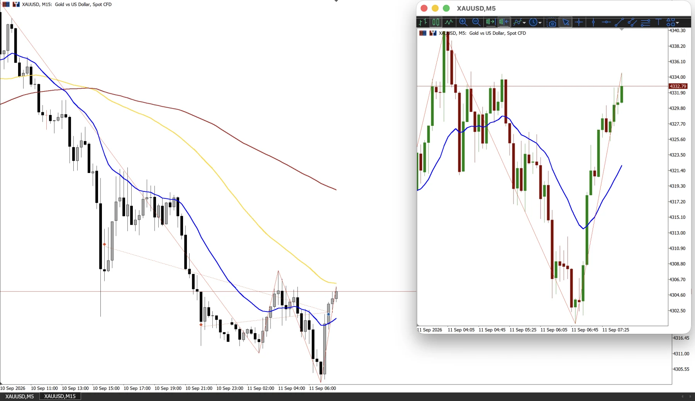
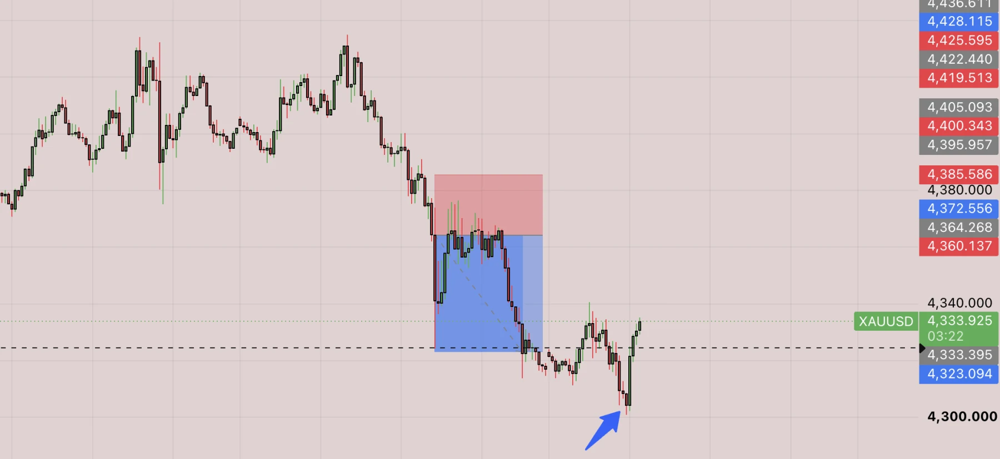
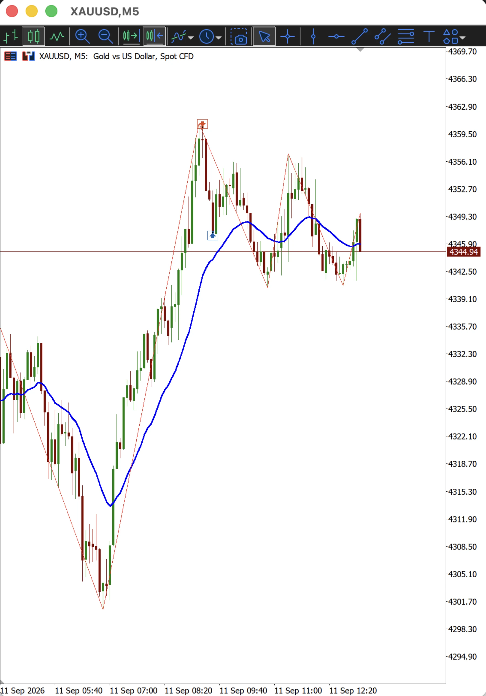
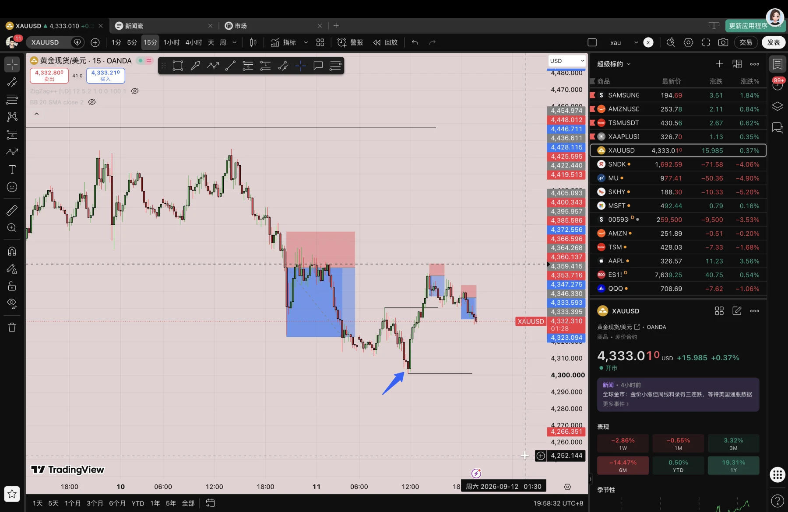
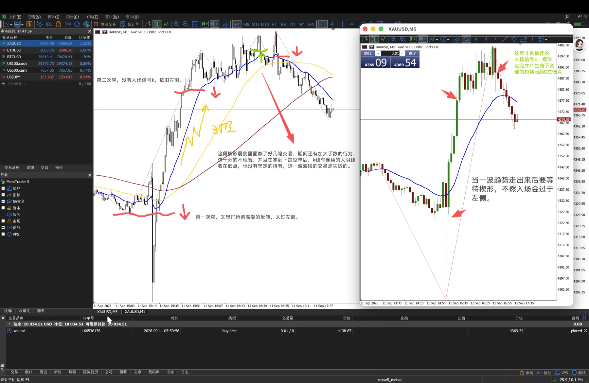

昨天做了两单，手数为 0.01，第一单做空做在了抢购高潮附近（并不是一个好的入场点），我以为回弹后会继续流畅的下跌，但实际上并没有，反而拉上去了，甚至一度触及到我的止损位，随后我调大止损，价格继续下跌，在凌晨的时候触发了我预设的 sell stop order，随后我继续持有，并计划继续加仓，但价格在触及 4300 关键支撑后迎来强烈反弹，我不得不清仓离场。

总的来看这笔交易无太大问题，在 aways short 市场中做空，当价格出现强烈反弹后离场，但有个小毛病就是入场过于粗糙，后续需要注意。

在强烈反弹到达 MM 位后我并没有急于做空，而是等到价格达到前期高点以及更大周期的 1/2 回调位后进行了一笔剥头皮交易，手数为 0.03，入场信号 k 为 pinbar，目标是十个点（十个点同时也是 21 日 ema 支撑位），因为我并不清楚这波小的上涨趋势是否结束，所以目标位并没有看的太远，这一单同样合理。

这一段是比较典型的楔形，一是价格突破震荡区间后发生抢购高潮型的下跌，随后快速反弹，形成楔形熊旗，随后继续下跌，二是价格触底反弹后在小上涨趋势中形成的楔形牛旗，不过尝试向上突破失败，并产生了向下的走势。

今晚 cpi 数据发布，我犯了好几个致命错误，并且没有遵守一天最多五单和连亏三单就停止交易的规则，其实我今天早上就赚够了钱，但后面还想继续赚，无视交易规则，为什么我还是做不到呢？甚至一度出现情绪略微失控的情况，请保持理智。

