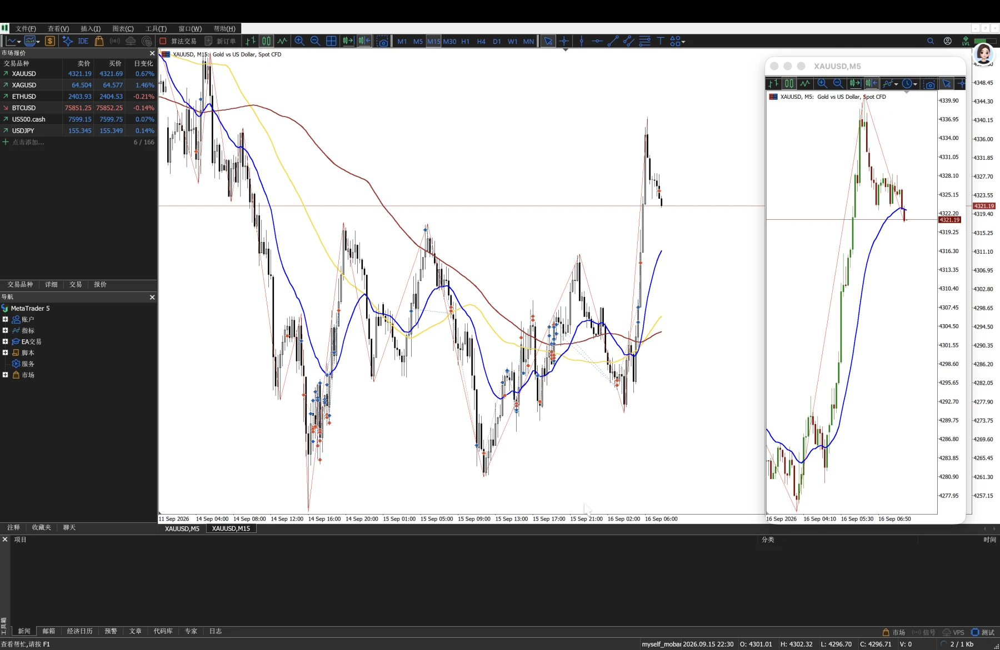
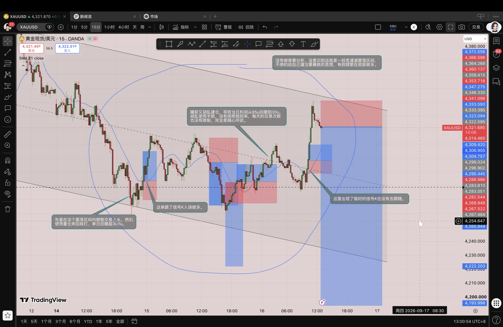
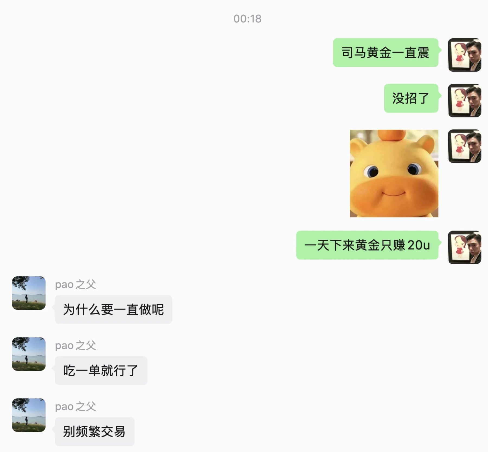
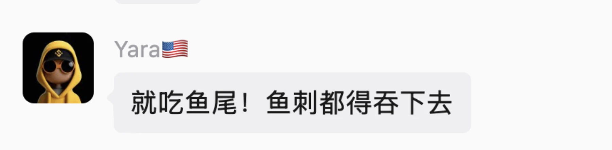
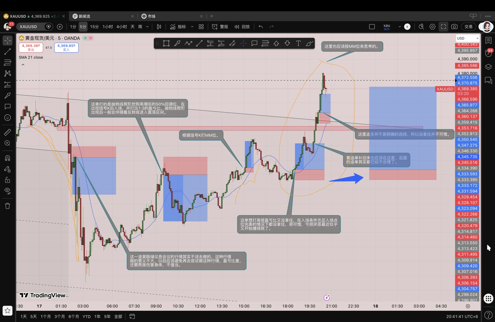

这个周前三天的交易很失败，先抛开交易技术不谈，仅交易规则就没有遵守，我的风控体系是写来做摆设的吗，又一次在震荡区间去频繁交易做突破，即使要做也应该做剥头皮啊，为什么要把目标位放那么远呢，导致频繁出现浮盈变止损的情况，然后心态炸裂报复性交易，随意点击建仓按钮，我其实不缺赚钱的交易，我每次赚钱后都会亏回去，其原因在于我贪心，吃完一段行情还想再吃一段，无穷无尽。

从这几天的交易里我又看见了从前的我，频繁交易报复性交易，重仓赌行情赌情绪，我不能再这样了，即使我没有很好的交易技术，我也应该要有很好的纪律意识，我是要当职业交易员的人，我的目光要放长远，这是我需要用一生去认真对待的事业，怎能被几笔交易就动摇？从今天起必须遵守交易规则，犯一次就十天不许交易，做不到就惩罚自己三天不吃饭。

小球和 yaya 这句话说的很对。

想要建立长期优势，就要接受短期劣势。

