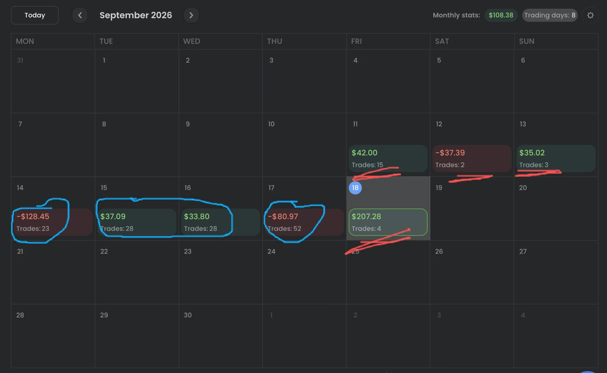
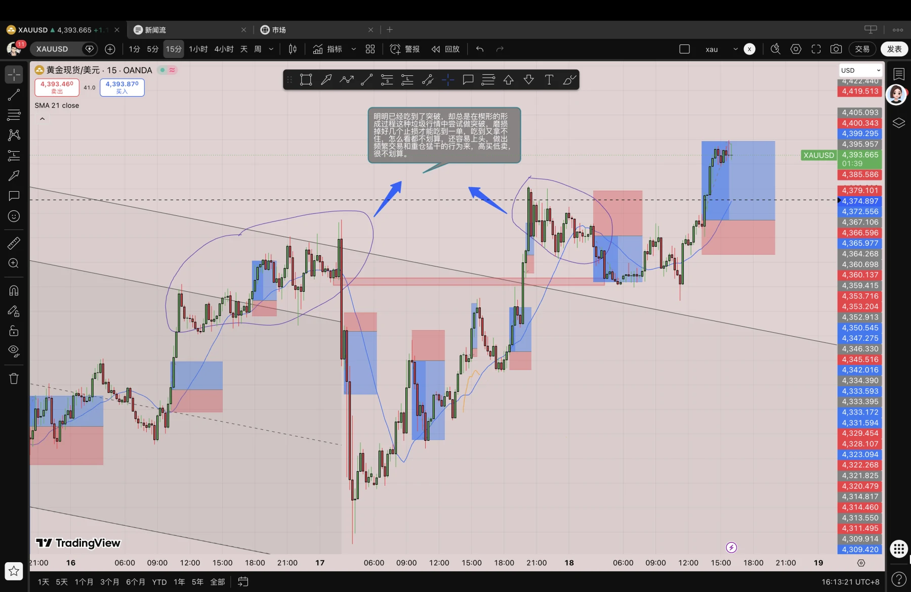
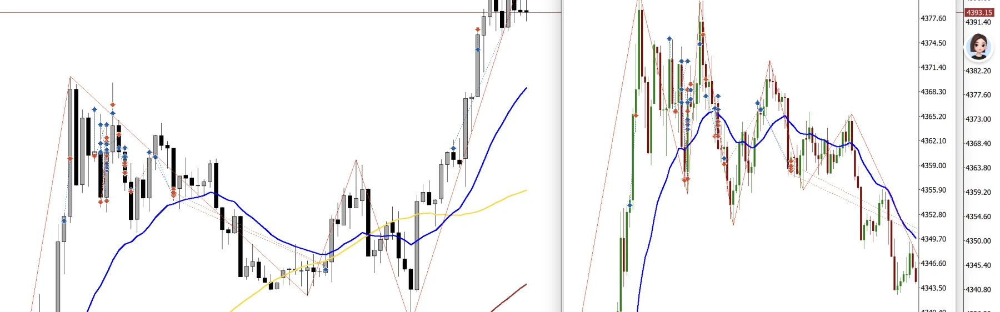
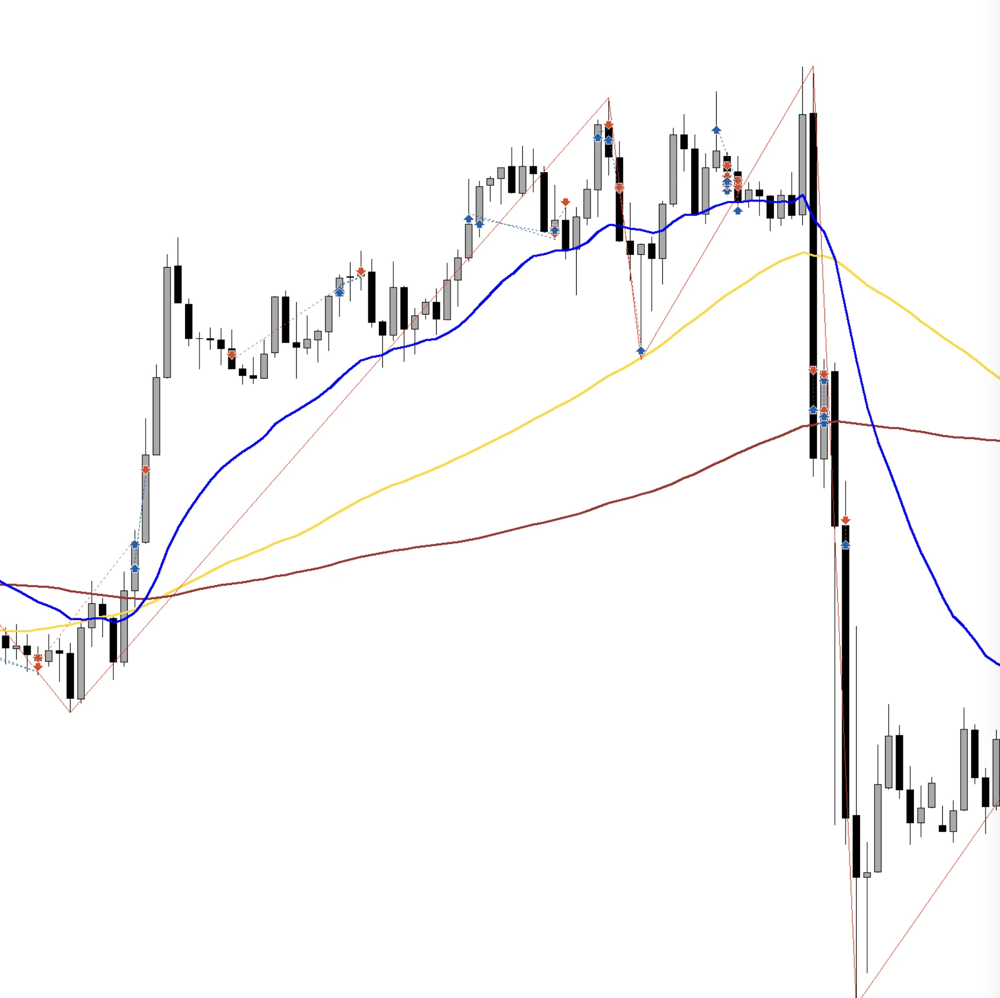
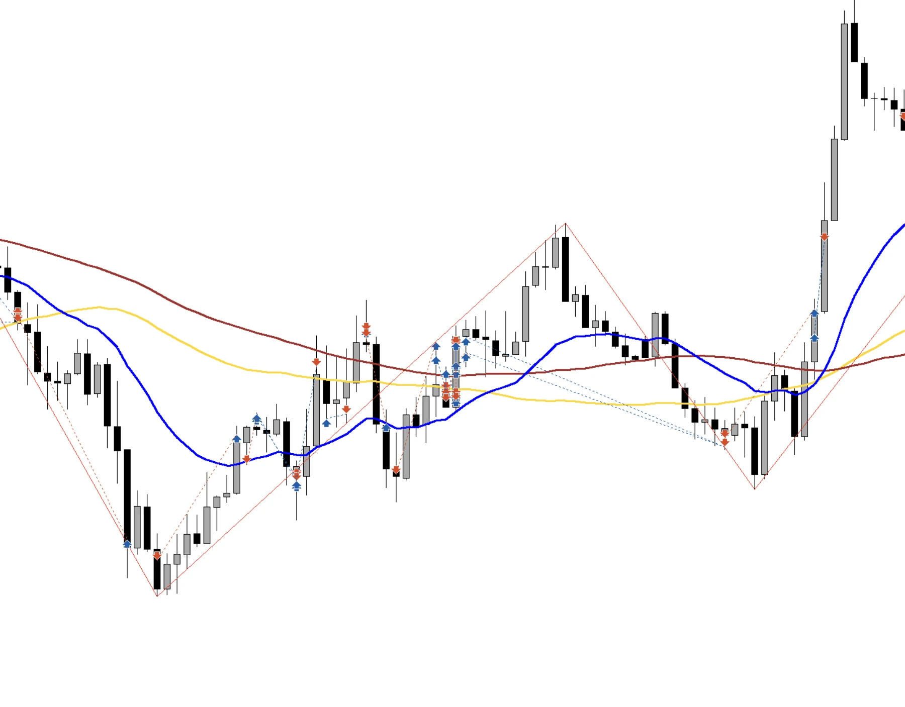

做交易不是越勤奋越好，在这个市场勤奋跟收入是不成正比的，从统计上来看，反倒是交易次数最少的那几天我赚的钱最多或亏的钱最少，所以我应该严格遵守我写的用于限制交易次数的交易规则，这是铁的纪律，不应该被打破。

最近几笔交易、或者说这个周的交易还是那个老毛病，“得了千钱想万钱，当了皇帝想成仙”，不是吃鱼尾的事儿了，我是想连鱼刺一起吞进去，贪心不足蛇吞象，我明明已经是一名波段交易者，却还想在吃到波段后，在楔形的形成阶段去做剥头皮交易，但我剥头皮又做不好，老是带着先入为主的“火箭”思维去做单，或者说我是在行情的缓冲阶段去做“喷发式”的突破行情，这跟我自己说的“急～缓～急～缓”都是相违背的，因为我习惯于在楔形或震荡区间的上下沿形成信号 K 后去做突破，拿一个比较大的盈亏比，但是往往在吃到一单后想去吃第二单，然后在楔形或震荡区间里用先入为主的突破思维去做单，并伴随强烈的亏损厌恶和报复式交易，什么是报复式交易呢？就是觉得行情在针对你，就跟你反着来，然后疯狂的点击开单键，忽视一切只想开单，傻逼吗这不是，哎，我这个周出现了两次这样的情况，还都是躺在床上要睡觉前干的破事，真不划算，真傻逼，我不应该把开平仓键当成毒品去吸食，因为我不是赌徒和毒狗，我要把这写进交易规则里面。

这些破单做它有什么意义呢，精神上心态上的风险敞口无限大，还耗费精力。

