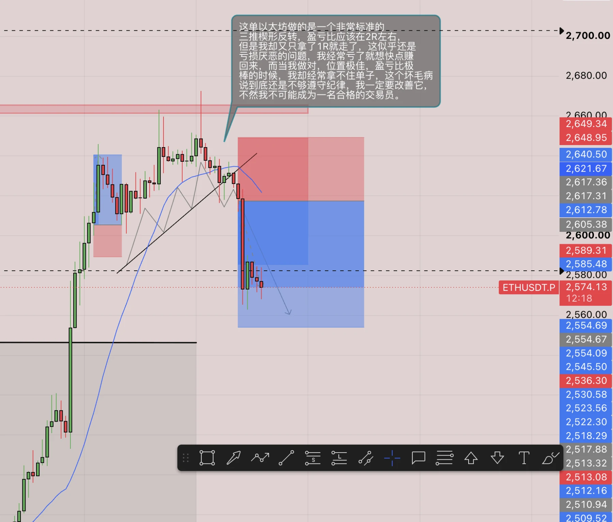
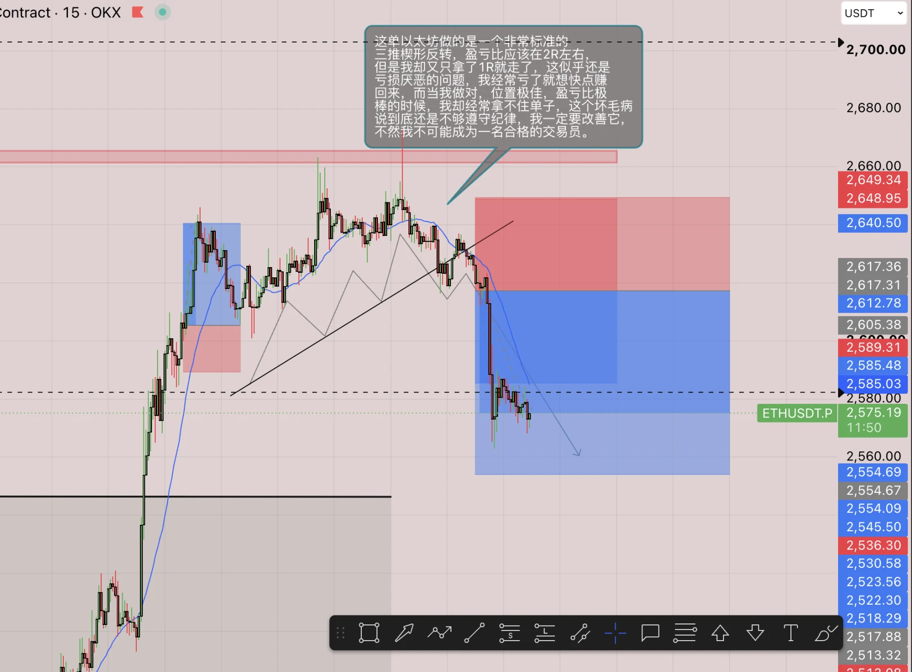
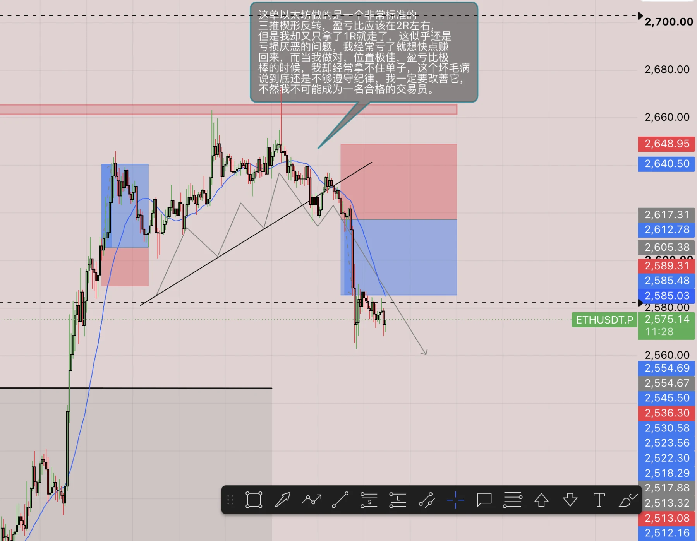

周末复盘，今天是周天，是我开始认真对待交易后的第一个周末，我觉得有必要好好整理一下思路，多说无益，我把我感悟最深的几点写出来：@1 只做看得懂的行、@2 必须严格遵守规则，要有纪律性、@3 做单前的思路顺序为“背景分析>形态结构>信号 K 线”，然后再去考虑胜率和盈亏比。

此外我周末还做了两笔以太的单子，其一是周五晚上的多单，但由于我睡着了忘记平仓，导致我在周六看着浮盈无法落袋，同时还要承担巨大风险，原因是交易所服务器运维，以后需要记住，尽量不要持仓过夜，其二是周天的空单，这单真的很可惜，还是没拿住，老是这样，赚钱的单子拿不住亏钱的单子想死拿，我觉得从现在起我真的应该锻炼自己的内心了，不然亏损厌恶真的会毁掉我的交易之路。

