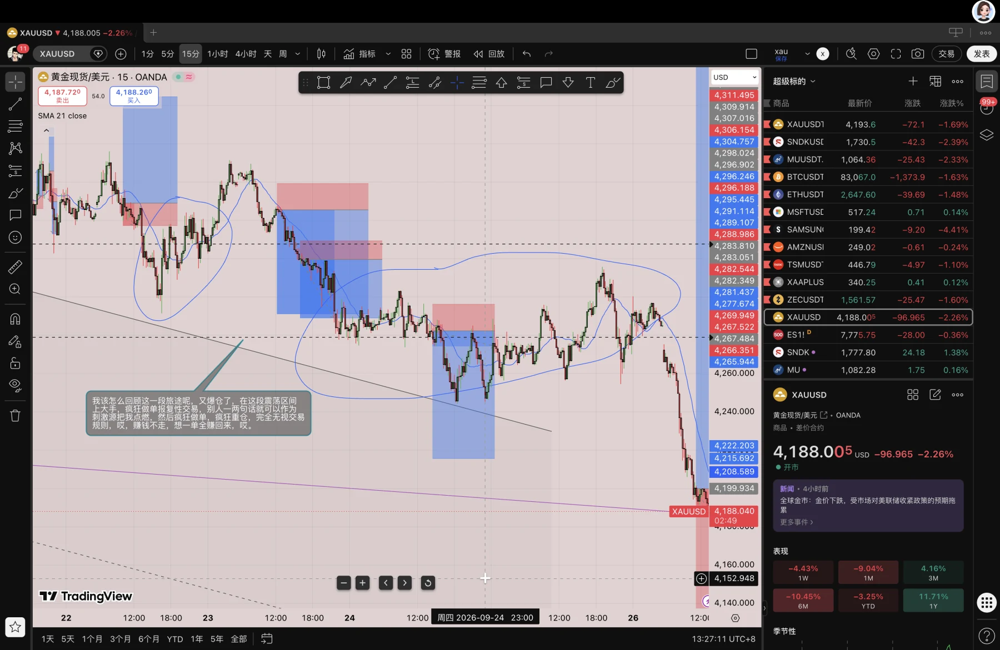

过去的一周我又爆仓了，其实不是爆仓，是重大回撤引起我的自信心遭受巨大打击，然后开始摆烂或报复性交易，想一单就把之前的亏损赚回来，然后开始重仓，开始赌行情，交易系统在此刻完全失效，那天晚上我明明已经水上了，结果 S 一句砸盘了，我就跟着魔了一样，冲进去盘都不看就立马重仓梭哈做空，结果行情依旧只是震荡，我打损几次，对，还是之前那种老毛病，在震荡区间频繁打损几次就上头了，然后继续回撤，上头，胡乱操作，最终导致考试号失败，爆仓归零，跟天空哥的聊天也导致我想要梭哈，想要一把通过考试号。

为什么我明明之前做的好好的，还是会爆仓呢。

我变坏的开始，是跟天空哥频繁聊天，受到他的梭哈思想的影响，然后频繁跟 S、小球等人讨论行情，然后我开始在床上做单，打完飞机后做单，在精神极度紧绷时做单，然后交易系统失效，再次上头爆仓。

为什么明明什么都知道，还是会爆仓，为什么我明明不愿见到所谓的小明，他却总能在我平静一段时间后找到我。

说到底那颗雷从一开始都在，一直埋在我的每一次侥幸每一次幻想里，我从最开始就没有真正认真对待交易，我从最开始就是抱着幻想来的，我从最开始就没有遵守交易系统，我从来没有真正认识过我自己，我从来没有真诚过，我从来没有问心无愧过，这样的我不配在交易中取得成功。

