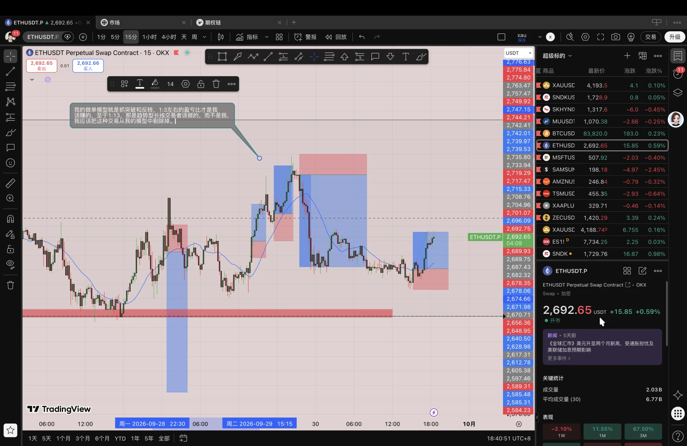
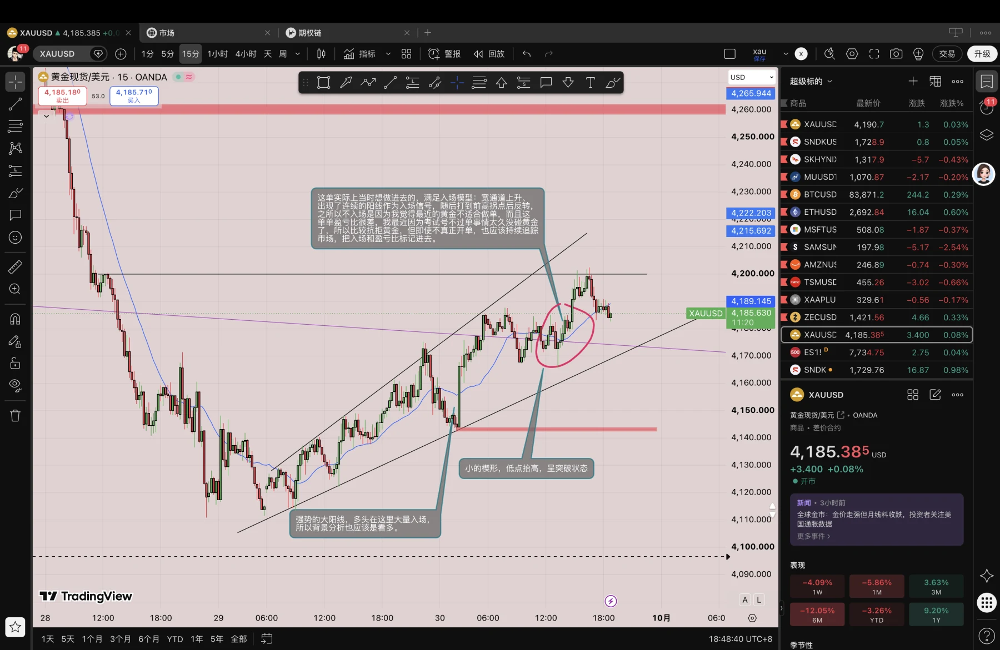

逐渐明确自己的交易模型，我是一名突破型交易者，我有敏锐的盘感，对价格的反转和突破的发生有着超出常人的嗅觉，但我仍需明确哪些钱是自己该赚的，哪些钱不是自己该赚的，当市场满足入场模型所需的条件时，不要犹豫，大胆做进去，剩下的交给概率，不要为一两笔盈亏就影响情绪，再耐心一点吧，接下来我要依托最近的交易继续总结和提炼自己的入场模型和做单类型了。

还有对黄金的一些解读，黄金这个周一开盘这波下跌让人始料不及，连续的大阴线收在低点，先抢购高潮，随后持续阴跌，没有较大反弹，后续的反转力量也是很薄弱，一路阴涨上去，给人一种还在震荡的错觉。

