靠生搬硬套公式是行不通的，靠事后找补也是行不通的，你到底是在复盘，还是在为自己的失败找借口。

先来看这单 btc，首先多单我没有做进去，空单做进去后也在半路跑路了，这个空单是 yara 喊单的，并不是我基于自己的理解去做的，事实上我当时还想开出多单去追涨做突破。

**4H：**

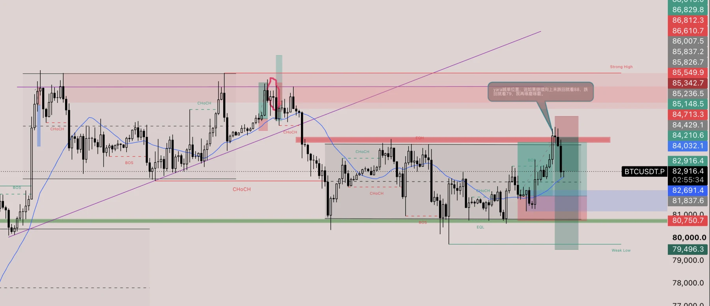

**1H：**

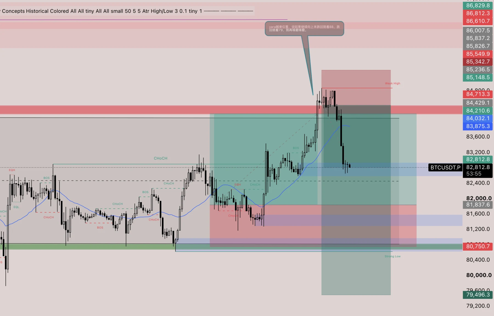

**15M：**

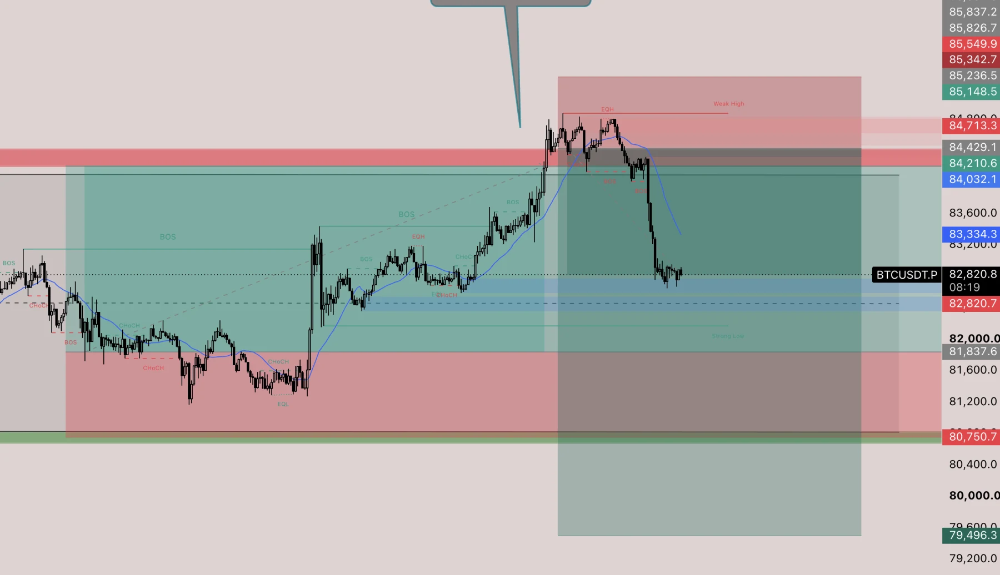

关于这单 BTC 之 Yara 的盘面和思路：

**4H：**

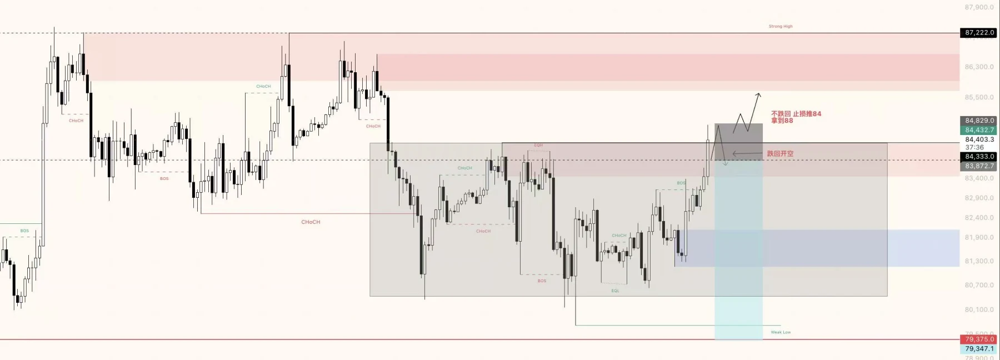

**1H：**

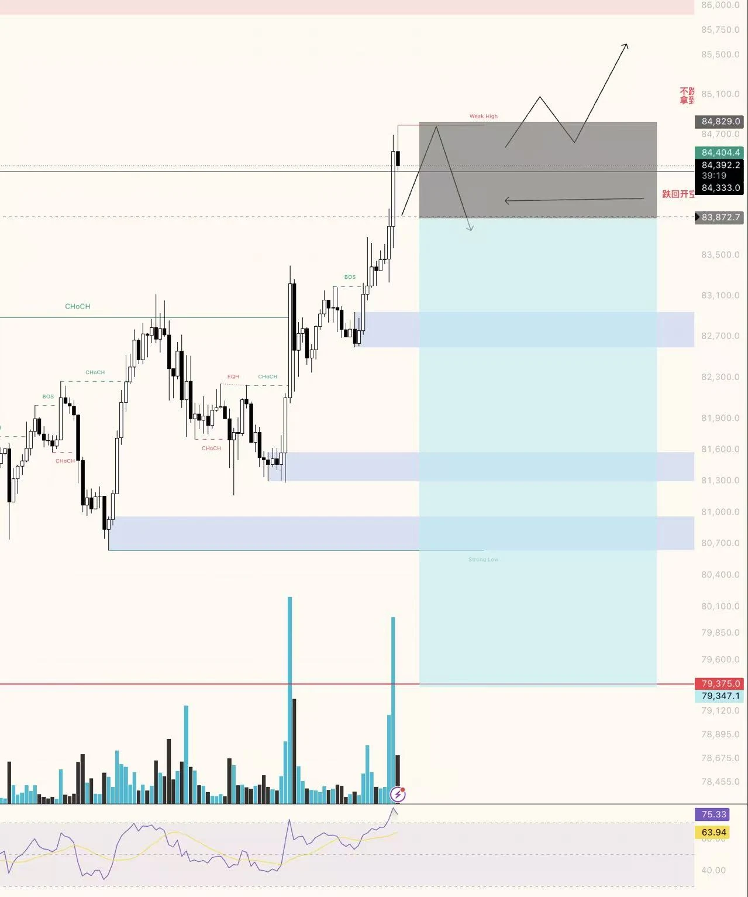

**5M：**

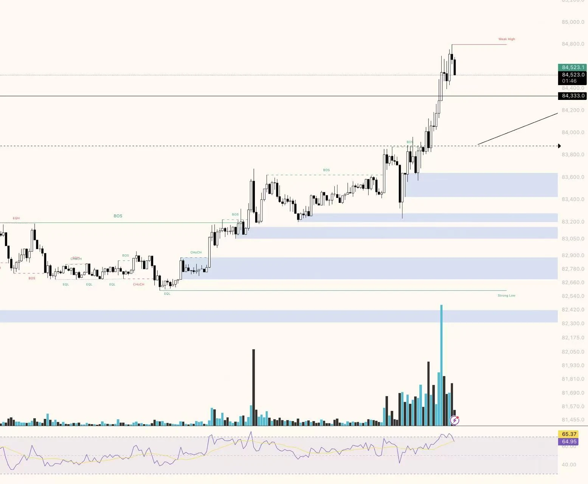

首先他把这单的大背景看成是震荡区间，尝试去突破上轨，如果能成功就顺势看 88、如果失败则跌破前低，突破的前提是回踩不深且持续强势向上，而不是直接回踩且一直不破前高，似乎是在等待结构的同时去寻找良好的强势信号 K。

再来看 zec：

**4H：**

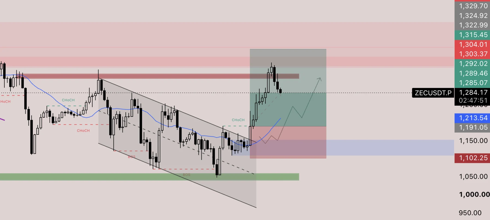

**1H：**

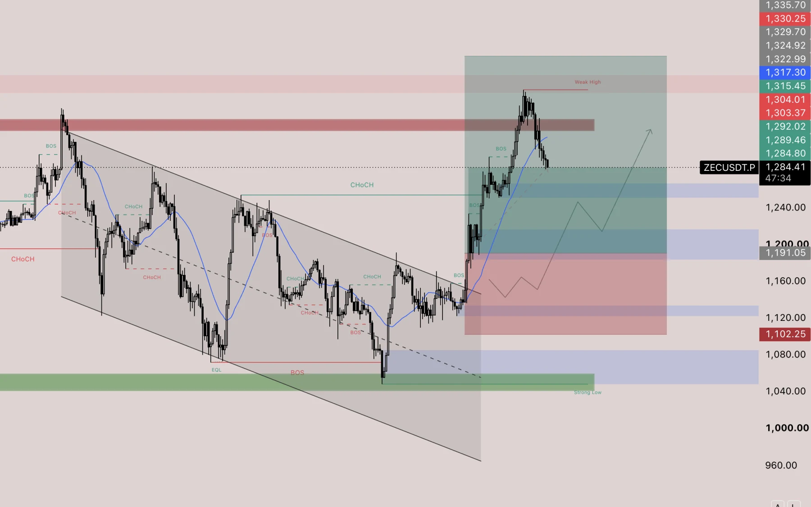

**15M：**

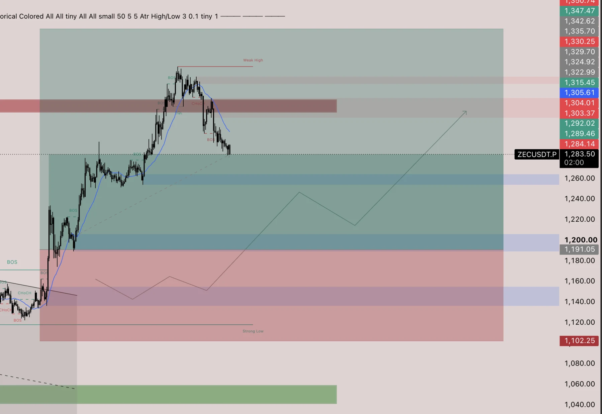

我个人觉得这一单十分可惜，因为我看对了而没有做进去，三推楔形被成功突破，回踩后出现连续的影线拉回，然后继续向上，且在启动前有针扫掉了流动性。

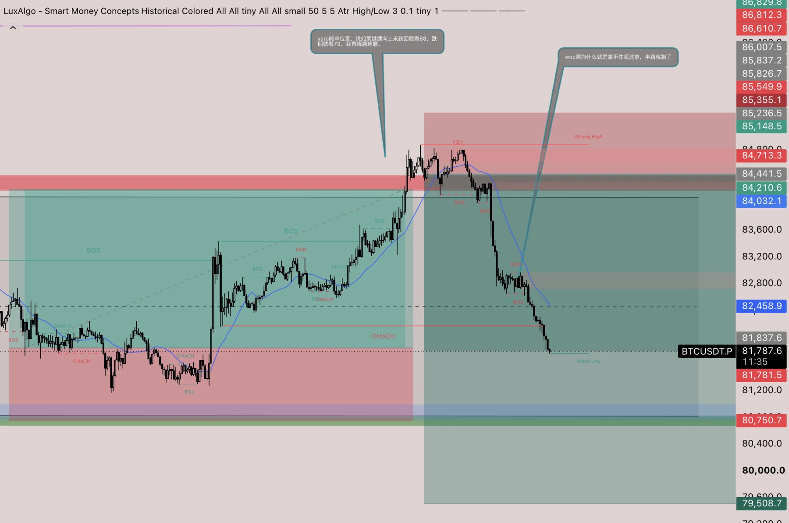

Yara 给我补充了一些关于那个空单的理解：

突破应该持续放量，vol 正向增长。

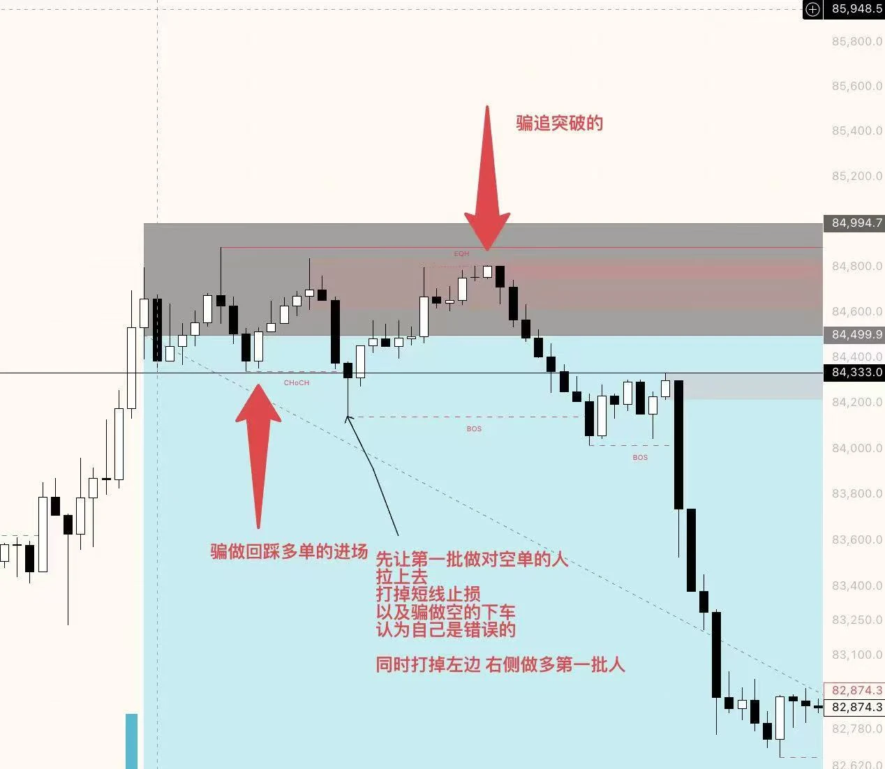

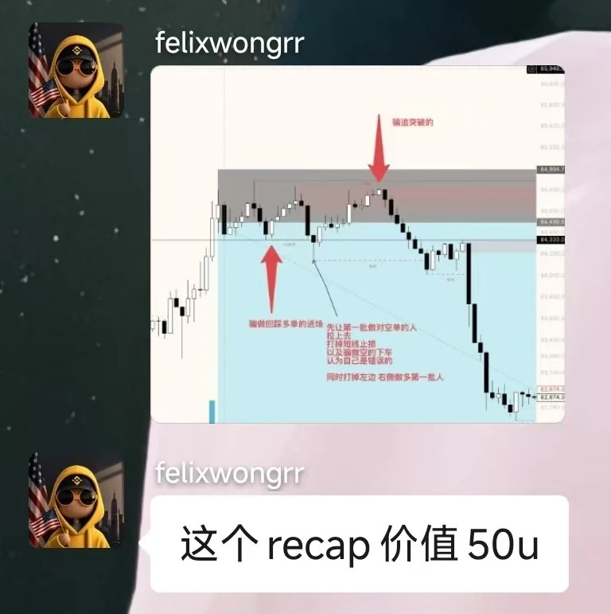

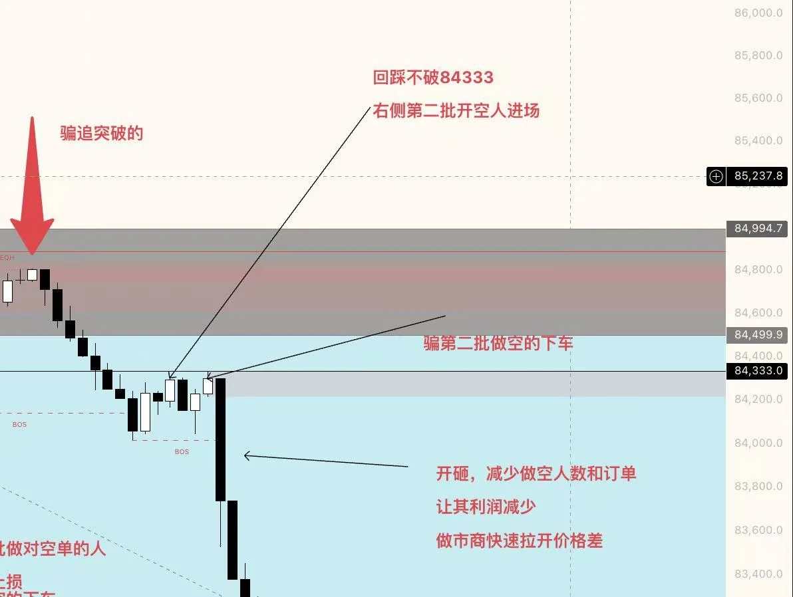

这波 SNDK 也是没做进去，不过事后分析复盘亦然有趣：

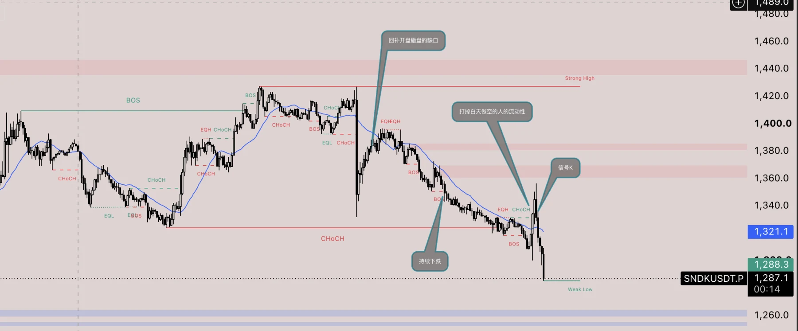

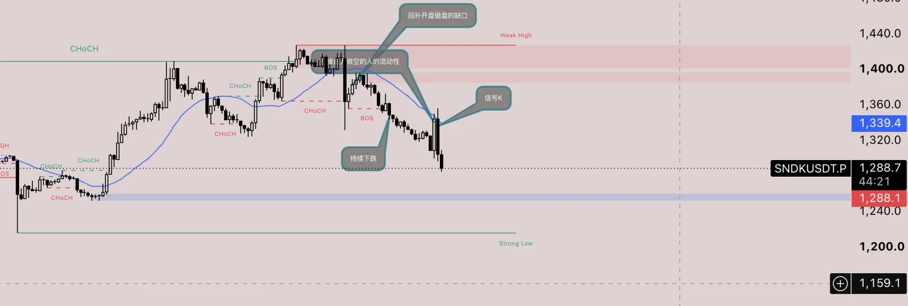
